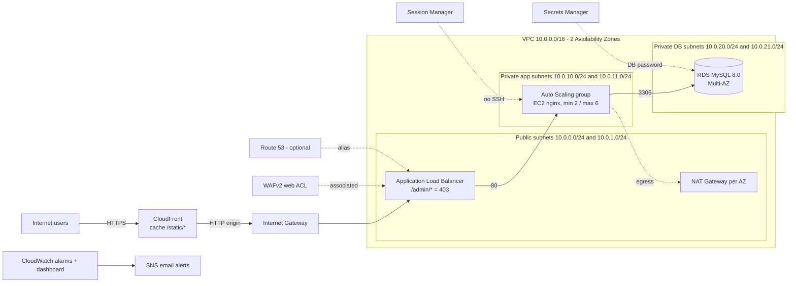

# Scalable Web Application on AWS (ALB + Auto Scaling + RDS Multi-AZ) — Terraform

A production-style, three-tier web platform on AWS, built entirely with Terraform.
Traffic flows **CloudFront → ALB (protected by WAF) → Auto Scaling group of EC2 instances in private subnets → RDS MySQL Multi-AZ** across two Availability Zones.

> **Author:** _Your Name_ · [LinkedIn](https://www.linkedin.com/in/your-profile) · _your-email@example.com_
> **Course:** AWS Solutions Architect – Associate · Graduation Project
> **Live demo / video:** _add link here (optional)_

---

## 1. Solution Architecture


The editable source is [`architecture/architecture.drawio`](architecture/architecture.drawio) (open it with [draw.io](https://app.diagrams.net)). This is the corrected diagram: the one embedded in the baseline report has off-by-one subnet CIDR labels.

<details>
<summary>Text version of the diagram (Mermaid)</summary>


</details>

### Request flow
1. The user opens the CloudFront URL over HTTPS (Route 53 alias is optional and was not enabled).
2. CloudFront serves `/static/*` from cache and forwards everything else to the ALB.
3. The WAF web ACL inspects each request at the ALB.
4. The ALB routes to healthy EC2 instances in the private app subnets (`/health` check); `/admin` and `/admin/*` return a fixed **403**.
5. The instances talk to RDS MySQL on port 3306 in the isolated DB subnets.
6. Instances reach the internet (package installs) only through the NAT Gateway of their own AZ.
7. Administrators connect only through **Session Manager** (no SSH, no key pair, no port 22).

---

## 2. AWS services and where they live in the code

| Service | What was built | File |
|---|---|---|
| **VPC** | 1 VPC, 6 subnets in 3 tiers across 2 AZs, Internet Gateway, one NAT Gateway per AZ, separate route tables, custom NACLs | `vpc.tf` |
| **Security Groups** | Chained: ALB SG → Web SG → RDS SG | `security.tf` |
| **EC2 + Auto Scaling** | Launch Template (Amazon Linux 2023, IMDSv2 required, encrypted gp3), ASG min 2 / desired 2 / max 6, ELB health checks, rolling instance refresh, target tracking (CPU 50 %, 500 requests per target) and a step-scaling policy | `compute.tf`, `user_data.sh` |
| **ALB** | Internet-facing ALB, target group with `/health`, HTTP listener (HTTPS listener ready when a certificate is supplied), L7 rule returning 403 for `/admin*` | `alb.tf` |
| **WAF** | WAFv2 web ACL: AWS managed Common, Known Bad Inputs, SQLi and Linux rule sets + rate limit (2,000 req / 5 min / IP) | `waf.tf` |
| **CloudFront** | ALB origin, `/static/*` cached (CachingOptimized), dynamic paths not cached, HTTP→HTTPS redirect for viewers | `cloudfront.tf` |
| **RDS** | MySQL 8.0 Multi-AZ, encrypted gp3 (20 GB, autoscaling to 100 GB), isolated DB subnets, master password generated and kept in Secrets Manager | `rds.tf` |
| **Route 53** | Alias record + health check on `/health` (optional, only when `domain_name` and `hosted_zone_id` are set) | `route53.tf` |
| **Systems Manager** | EC2 role with `AmazonSSMManagedInstanceCore` + `CloudWatchAgentServerPolicy` | `iam.tf` |
| **CloudWatch + SNS** | SNS email topic, 5 alarms (ASG CPU, ALB 5xx, unhealthy hosts, RDS CPU, RDS free storage), 1 dashboard | `monitoring.tf` |

### Network addressing

| Tier | AZ A | AZ B |
|---|---|---|
| Public (ALB, NAT) | 10.0.0.0/24 | 10.0.1.0/24 |
| Private app (EC2) | 10.0.10.0/24 | 10.0.11.0/24 |
| Private DB (RDS) | 10.0.20.0/24 | 10.0.21.0/24 |

### Security design
- **Layered Security Groups:** ALB (80/443 from the internet) → Web (80 from the ALB SG only) → RDS (3306 from the Web SG only).
- **NACLs** on public and private subnets; DB subnets have no route to the internet.
- **Instances:** no public IP, no key pair, no SSH, IMDSv2 required, encrypted EBS.
- **Data:** RDS storage encrypted; master password managed by RDS in Secrets Manager (not in Terraform state).
- **Edge:** WAF managed rules + rate limiting; CloudFront in front.

---

## 3. Deployment

### Prerequisites
- Terraform **>= 1.5**, AWS CLI configured (`aws configure`), an AWS account with permissions to create the resources above.

### Steps
```bash
git clone <this-repo-url>
cd scalable-web-app-terraform

cp terraform.tfvars.example terraform.tfvars   # set alert_email (and optionally single_nat_gateway = true)
terraform init
terraform plan
terraform apply
```
After `apply`: confirm the **SNS subscription** from your inbox, then open the `app_url_via_cloudfront` output. CloudFront can take a few minutes to finish deploying.

### Outputs
`alb_dns_name`, `cloudfront_domain`, `app_url_via_cloudfront`, `rds_endpoint`, `rds_secret_arn`, `asg_name`, `ssm_connect_hint`.

### Key variables
| Variable | Default | Notes |
|---|---|---|
| `region` | `us-east-1` | |
| `vpc_cidr` | `10.0.0.0/16` | |
| `instance_type` | `t3.micro` | |
| `asg_min / desired / max` | `2 / 2 / 6` | |
| `single_nat_gateway` | `false` | set `true` to save cost in labs |
| `db_instance_class` | `db.t3.micro` | |
| `db_skip_final_snapshot` | `true` | lab setting |
| `domain_name`, `hosted_zone_id`, `certificate_arn` | empty | optional; enables Route 53 and HTTPS |

---

## 4. Testing

| # | Test | Command / action | Expected |
|---|---|---|---|
| 1 | Site through CloudFront | open `app_url_via_cloudfront`, refresh | Instance ID and AZ change between refreshes |
| 2 | ALB layer 7 rule | `curl -i http://<alb_dns_name>/admin/` | `403 Forbidden` |
| 3 | WAF | `curl "http://<alb_dns_name>/?q=<script>alert(1)</script>"` | `403` from WAF |
| 4 | CloudFront cache | `curl -I https://<cloudfront_domain>/static/style.css` twice | `X-Cache: Miss` then `Hit` |
| 5 | Session Manager | `aws ssm start-session --target <instance-id>` | Shell without SSH |
| 6 | Auto Scaling | on an instance: `sudo dnf install -y stress-ng && stress-ng --cpu 2 --timeout 600` | Instance count rises above 2 |
| 7 | RDS failover | `aws rds reboot-db-instance --db-instance-identifier <id> --force-failover` | AZ changes, service recovers |

Test evidence (screenshots and command output) goes in [`docs/screenshots/`](docs/screenshots/); see [`docs/EVIDENCE_CHECKLIST.md`](docs/EVIDENCE_CHECKLIST.md).

---

## 5. Cost awareness

These are billed by the hour while they exist, even when idle: **2 NAT Gateways, the ALB, RDS Multi-AZ, and the EC2 instances.** CloudFront, WAF and CloudWatch are usage-based and small at lab traffic. Use `single_nat_gateway = true` during labs and always clean up afterwards.

## 6. Cleanup
```bash
terraform destroy
```

---

## 7. Challenges and lessons learned

| Problem | Cause | Fix |
|---|---|---|
| `apply` failed with "already exists" for ALB, ASG, DB subnet group and WAF ACL | A previous apply created the same names but the local state no longer tracked them | Removed the orphaned resources and re-applied. **Lesson:** use remote state with locking |
| RDS failed with `FreeTierRestrictionError` | Free Tier plan limits the backup retention period | Set `backup_retention_period = 1` and disabled Performance Insights; Multi-AZ still works |
| Emoji displayed as garbled characters | The generated HTML had no charset | Added `<meta charset="utf-8">` in `user_data.sh` (triggers a rolling instance refresh) |

## 8. Known limitations and future improvements

Documented honestly in [`docs/baseline-report.pdf`](docs/baseline-report.pdf). Main items:

1. **Remote state** in S3 with versioning, encryption and locking (the local state caused the orphaned-resource issue).
2. **Lock the ALB to CloudFront** (managed prefix list + secret origin header, default action 403) — today the ALB can be reached directly, bypassing CloudFront.
3. **HTTPS end to end** with ACM + Route 53 (CloudFront → ALB is plain HTTP in this deployment).
4. Refactor into **modules** with dev/prod environments.
5. VPC endpoints, KMS customer-managed keys, VPC Flow Logs, CloudTrail, ALB and WAF logging.
6. Production RDS settings: deletion protection, final snapshot, 7-day backups.
7. **CI/CD** (GitHub Actions: `fmt`, `validate`, `tflint`, `tfsec`/Checkov, plan on PR, Infracost).
8. Replace the static nginx demo with a small real app that uses the database and Secrets Manager; add the CloudWatch agent.

---

## 9. Repository structure
```
.
├── README.md
├── architecture/architecture.drawio   # editable diagram
├── docs/
│   ├── architecture.png               # exported diagram
│   ├── baseline-report.pdf
│   ├── EVIDENCE_CHECKLIST.md
│   └── screenshots/
├── versions.tf  variables.tf  outputs.tf
├── vpc.tf  security.tf  iam.tf  compute.tf  alb.tf
├── waf.tf  rds.tf  cloudfront.tf  route53.tf  monitoring.tf
├── user_data.sh
├── terraform.tfvars.example
├── .terraform.lock.hcl
└── .gitignore                         # excludes state files and terraform.tfvars
```
